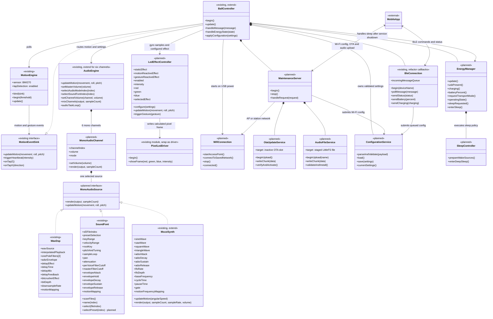

# Visioball class diagram

Dit diagram beschrijft de beoogde architectuur. `<<existing>>` bestaat al in de firmware; `<<planned>>` is nieuw werk. Het diagram is dus ook een voorstel voor de stappen die nodig zijn om USB-onderhoud, OTA, uploads en energiebeheer toe te voegen.

## Klassendiagram

Alle onderdelen staan in één diagram. De klassen zijn in de bron per subsysteem gerangschikt; Mermaid toont geen groepskaders of groepstitels.

De configuratie kiest het effecttype. `MotionEngine` levert gyroscoopdata via `BallController` aan `LedEffectController`, die de pixelwaarden berekent. `PixelLedDriver` schrijft alleen het berekende frame naar de LEDs; gyro- en effectlogica hoort daar niet thuis. De huidige firmware ondersteunt nog statische LED-instellingen; motion-effecten zijn gepland.

De zes mono-kanalen zijn logische mixkanalen met elk een eigen volume en bronselectie. `AudioEngine` telt ze op tot één mono mix die via de bestaande stereo-I2S-uitgang wordt afgespeeld. Dit is gepland werk: de huidige firmware heeft één globale audiomodus en geen zes-kanaalsmixer.

De referentie-implementatie van Mozzi gebruikt golfvormselectie, ADSR en LFO-frequentiemodulatie als onderdeel van een sound preset. Dit zijn synthese-instellingen, geen post-processing-effecten zoals de WAV-delay en bitcrusher. Voor zes kanalen moeten oscillator-, envelope- en LFO-status per kanaal onafhankelijk zijn.

De SF2-keuze heeft twee niveaus: `soundFontFileIndices[6]` kiest per kanaal een `.sf2`-bestand. `soundFontPresetIndices[6]` is een toekomstige uitbreiding; de huidige parser gebruikt de eerste preset in het gekozen bestand.

## Verantwoordelijkheden

| Klasse | Verantwoordelijkheid | Hoort hier niet thuis |
| --- | --- | --- |
| `BallController` | Coördineert motion, audio, BLE/configuratie, energie en onderhoudsmodus. | Hardwaredetails, protocolparsing of audio-rendering. |
| `MotionEngine` | Leest de BMI270, detecteert tikken en meldt motion-events aan de controller. | Audio- of LED-uitvoer rechtstreeks aansturen. |
| `AudioEngine` | Beheert zes mono-kanalen, hun volumes, mix en I2S-uitvoer. | BLE, Wi-Fi, uploads of configuratieparsing. |
| `MonoAudioChannel` | Rendert één bron in mono met eigen volume en geselecteerde modus. | Andere kanalen mixen of hardware-output beheren. |
| `WavDsp` | WAV playback, interpolatie, filters, ADSR, Delay en Bitcrusher; motion koppelt aan pitch/effecthoeveelheid. | Mozzi- of SoundFont-instellingen. |
| `MozziSynth` | Waveform, ADSR, LFO en presetparameters voor een Mozzi-kanaal. | WAV post-processing of kanaalvolumes van andere kanalen. |
| `SoundFont` | Laadt SF2-bestanden en beheert zones, voices, loop, pan, attenuation, filters en envelopes. Preset-indexkeuze is nog gepland. | BLE-berichten of audio-mixoutput. |
| `ConfigurationService` | Parseert/valideert en bewaart configuratie; levert gevalideerde instellingen aan `BallController`. | BLE-/HTTP-transport of audio-/LED-hardware rechtstreeks aansturen. |
| `BleConnection` | Beheert BLE en zet inkomende berichten in een queue; verstuurt status. | Configuratie opslaan of blocking verwerking in callbacks. |
| `LedEffectController` | Past gekozen LED-instellingen toe en vertaalt motion/gebaar naar een pixel-effect. | BLE-JSON, sensor-uitlezing of protocolbeheer. |
| `PixelLedDriver` | Schrijft berekende pixelwaarden naar de LEDs van de bal. | Effectkeuze of bewegingsverwerking. |
| `EnergyManager` | Leest USB-/batterijstatus, bepaalt energietoestand en kiest wanneer deep sleep nodig is. | De batterij fysiek laden; dat doet de charger-hardware. |
| `SleepController` | Configureert wake-upbronnen en voert deep sleep uit op verzoek van `EnergyManager`. | Energiebeleid of transportmodus bepalen. |
| `WifiConnection` | Start AP of verbindt met een opgeslagen netwerk tijdens USB-onderhoud. | HTTP-routes, OTA-validatie of audio-assets verwerken. |
| `MaintenanceServer` | Routeert Wi-Fi-verzoeken naar configuratie, firmware-update of audio-upload. | Radio-/batterijbeleid of realtime audio. |

## Taakverdeling

| Uitvoering | Eigenaar | Werk |
| --- | --- | --- |
| `SystemTask` op Core 0, bestaande 5 ms-loop | `BallController` | BLE-queue legen, motion bijwerken en motion-/gesture-events doorzetten naar audio en LED-effecten; configuratie toepassen en `EnergyManager` periodiek pollen. Batterijmeting kan bijvoorbeeld op 1 Hz lopen binnen deze taak. |
| `AudioDspTask` op Core 1, hoge prioriteit | `AudioEngine` | Alleen audio renderen en I2S vullen. Geen Wi-Fi, BLE, JSON, LittleFS-upload of blocking locks in het audiopad. |
| BLE-callbackcontext | `BleConnection` | Frame kopiëren/enqueue en snel terugkeren. Geen filesystem-, sleep- of audio-enginewerk vanuit callbacks. |
| Wi-Fi/server-eventcontext, lage prioriteit | `MaintenanceServer` en uploadservices | HTTP-verzoeken en gechunkte uploads verwerken; firmware/audio eerst staging en validatie geven. Houd dit gescheiden van de audio-render taak. |
| Sleep-transitie | `BallController` coördineert; `EnergyManager` beslist en `SleepController` voert uit | Nieuwe uploads stoppen, onderhoudsserver/Wi-Fi sluiten, BLE-status versturen en radio/audio gecontroleerd stoppen. Daarna `EnergyManager.enterSleep()` aanroepen; die delegeert wake-source-configuratie en deep sleep naar `SleepController`. |

## Belangrijke randvoorwaarden

- BLE blijft tijdens normaal gebruik actief en ontvangt commando's onafhankelijk van Wi-Fi. USB-power start daarnaast Wi-Fi in AP-modus of op een opgeslagen netwerk; configuratie bepaalt de voorkeur. Ontbreken stationgegevens of lukt verbinden niet, start dan een onderhouds-AP als herstelpad.
- Deep sleep en continu BLE ontvangen kunnen niet tegelijk. Transportmodus moet daarom expliciet de radio's uitschakelen; alleen een fysieke wake-bron of USB-detectie kan de bal weer wekken.
- De huidige `partitions.csv` heeft een `factory`-appslot en geen `ota_0`/`ota_1`-slots. OTA vereist een dual-slot OTA-partitie-indeling, waardoor er minder ruimte overblijft voor LittleFS.
- De huidige code heeft geen USB/VBUS-detectie of batterijmeting. `EnergyManager` moet worden gekoppeld aan de werkelijke charger-IC, batterijmeting en wake-pin van het board; verzin deze signalen niet op basis van alleen USB-CDC.
- Audio-upload moet naar een tijdelijk bestand schrijven, valideren en pas daarna atomair activeren. OTA moet het inactieve slot volledig schrijven en verifiëren voordat het wordt geselecteerd.
